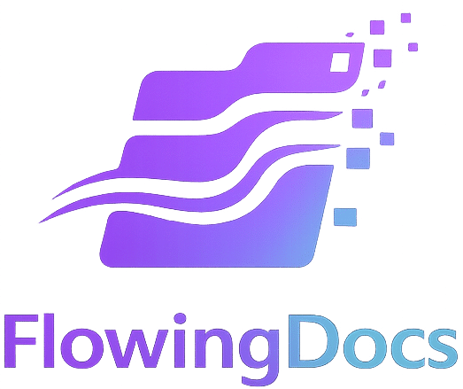

<div align="center">
  <a href="https://github.com/heywalter/flowingdocs">
    
  </a>

  <h1 align="center">FlowingDocs</h1>

  <p align="center">
    <strong>Work, Tools & Everyday Life</strong>
  </p>

  <p align="center">
    <i>"Knowledge flows, value grows."</i>
  </p>

  <p align="center">
    <a href="https://github.com/facebook/docusaurus">
      
    </a>
    <a href="./LICENSE">
      
    </a>
    <a href="https://creativecommons.org/licenses/by-nc/4.0/">
      
    </a>
    <a href="https://app.netlify.com/start/deploy?repository=https://github.com/heywalter/flowingdocs">
      
    </a>
  </p>
</div>

<br />

## 📖 About

**Flowing Docs / 知流小记** is Walter’s personal blog about work, tools, and everyday life. Topics include AI tools, self-hosted services, technical writing, and personal projects.

The repository also includes a technical-writing section with practical notes and interactive examples, alongside the blog and project pages.

## ✨ Features

- **🚀 Modern Tech Stack**: Built with [Docusaurus v3](https://docusaurus.io/), React, and TypeScript.
- **🎨 Beautiful UI**: Clean, responsive design with automatic Dark Mode support using TailwindCSS.
- **🔍 Full-Text Search**: Integrated **Algolia DocSearch** for instant content retrieval.
- **💬 Interactive Comments**: Powered by **Giscus** (GitHub Discussions) for community engagement.
- **📱 PWA Support**: Installable as a desktop/mobile app with offline reading capabilities.
- **🌍 Internationalization**: Native support for **i18n** (Chinese/English).
- **📊 Analytics**: Integrated Google Analytics 4 for visitor insights.

## 🛠️ Tech Stack

- **Framework**: [Docusaurus v3](https://docusaurus.io/)
- **Styling**: [TailwindCSS](https://tailwindcss.com/) & Custom CSS
- **Search**: [Algolia](https://www.algolia.com/)
- **Hosting**: [Netlify](https://www.netlify.com/)
- **Comments**: [Giscus](https://giscus.app/)

## 🚀 Getting Started

### Prerequisites

- Node.js (version 20.0 or above)
- pnpm (recommended) or npm

### Installation

1. **Clone the repository**
   ```bash
   git clone https://github.com/heywalter/flowingdocs.git
   cd flowingdocs
   ```

2. **Install dependencies**
   ```bash
   npm install
   # or pnpm install
   ```

3. **Start the development server**
   ```bash
   npm start
   # or pnpm start
   ```
   The site will open automatically at `http://localhost:3000`.

## 📂 Project Structure

```text
flowingdocs/
├── blog/             # Blog posts & authors config
├── docs/             # Knowledge base (structured docs)
├── data/             # Static data (features, friends, social)
├── i18n/             # Internationalization translations
├── src/
│   ├── components/   # Custom React components
│   ├── css/          # Custom global styles
│   ├── pages/        # Standalone pages (Home, About, etc.)
│   └── theme/        # Swizzled Docusaurus theme components
├── static/           # Static assets (Images, favicons)
├── docusaurus.config.ts  # Main configuration
└── tailwind.config.ts    # Tailwind CSS configuration
```

## Homepage updates

The homepage is generated when the site builds; an already-running static preview does not reload source edits automatically.

- Blog: shows the three newest published posts by `date`, independent of pinned blog-list entries. Updating an older article does not move it to the front unless its date changes.
- Titles, summaries, and images come from each post's front matter. Optional `homepage_title` and `homepage_description` fields provide shorter homepage captions; otherwise `title` and `description` are used. If a short caption exists, update it in the same article file when its meaning changes. Localized posts maintain their own captions.
- Documentation: the homepage keeps three curated subject links. Changes within those subjects appear after rebuilding. Adding a new subject to the homepage is an editorial decision; it does not automatically create another homepage entry.
- Projects: the two featured projects are curated rather than a live feed.

Run `pnpm build` and deploy the new output for changes to appear on the public site. Search indexing is handled separately by Algolia.

## Readable content and language metadata

`pnpm build` regenerates `static/llms.txt`, `static/llms-full.txt`, the per-page Markdown files and local assets in `static/llms/`, and `src/data/reading-metadata.json`. These are generated outputs; edit their sources instead. The static exports and publishing-template ZIP are ignored by Git and recreated during the build. The small `src/data/reading-metadata.json` snapshot is committed because type checking and local development import it before a build. Run `pnpm llms` to refresh them without building the site.

- Documentation uses the curated source list in `scripts/generate-llms-txt.mjs`. Published Chinese and English blog files are discovered automatically; drafts and unlisted posts are excluded. Obsolete generated copies are removed.
- Code fences and inline code retain their original content. Prose links are resolved to published pages, downloads and assets; unresolved source links fail generation.
- The markup workshop’s expandable text reference is rendered in the initial HTML. It shares syntax, examples and reuse data with the interactive lessons; changes to those data also appear in the Markdown export.
- Blog tag `hreflang` declarations require an explicit, unambiguous translation pair with matching article membership. Navigation may offer a broader fallback, but search metadata never advertises that fallback as an equivalent page. The SiteMetadata override follows Docusaurus 3.9.2 and should be compared with upstream when upgrading.

After building, run:

```bash
pnpm test:ai-content build
pnpm check:site-links
```

The first command verifies example preservation, exported links, initial HTML content and reciprocal language declarations. The second checks HTML links and assets, including canonical and alternate metadata. These checks do not establish search-engine indexing or verify external websites.

## 🤝 Contributing

Contributions are welcome! If you find a typo or want to improve a section:

1. Fork the project
2. Create your feature branch (`git checkout -b feature/AmazingFeature`)
3. Commit your changes (`git commit -m 'Add some AmazingFeature'`)
4. Push to the branch (`git push origin feature/AmazingFeature`)
5. Open a Pull Request

## 📄 License

- **Source Code**: Licensed under the [MIT License](./LICENSE).
- **Content**: Licensed under [CC BY-NC 4.0](https://creativecommons.org/licenses/by-nc/4.0/).

---

<div align="center">
  <p>Created with ❤️ by <strong>Walter Gui</strong></p>
  <p>
    <a href="https://github.com/heywalter">GitHub</a>
  </p>
</div>

### Release checks

Use Node.js 24 and the pnpm version in `package.json`. After installing dependencies with `pnpm install --frozen-lockfile`, run:

```bash
pnpm check:release
```

This command stops at the first failure and runs, in order:

1. ESLint and TypeScript checks.
2. Markup exercise and locale navigation checks.
3. The downloadable publishing template: extract the ZIP, install its locked dependencies, build it independently, and check both language examples, images, merged tables, and notices.
4. The complete Chinese and English site build into `build/`.
5. Built blog pages: complete archives and topic lists, article history with the current article indicated, and visible project filters.
6. Local page, anchor, asset, and metadata link checks.
7. AI-readable exports, preserved code examples, initial HTML reference content, and reciprocal language metadata checks.

The individual scripts remain available in `package.json`. Type checking covers the application source; `skipLibCheck` excludes upstream declaration files that target different React or DOM type versions. The publishing-template check needs Python 3 and npm registry access when packages are not cached. Building thumbnails also uses the network.

`.github/workflows/verify.yml` runs the same command on pull requests, pushes to `main`, and manual runs. It uses Node.js 24, the locked pnpm version, read-only repository permissions, and pinned Actions. The workflow takes effect after it is pushed to GitHub. Requiring its `Release checks` result before merging is a repository branch-rule setting.

Before publishing, also walk through the mobile navigation, project filters, markup exercises, downloads, and comment-loading states in the browser. Preserve existing exercise drafts while testing. The MySQL exercises use their own browser storage key; earlier drafts remain available for download from the workshop introduction.

After deployment, confirm Algolia has indexed the new pages, Analytics records real page transitions, and comments work on the public domain. Browser viewport checks do not replace a real-phone check, including the operating system's reduced-motion setting. Automated checks do not verify those external services.
