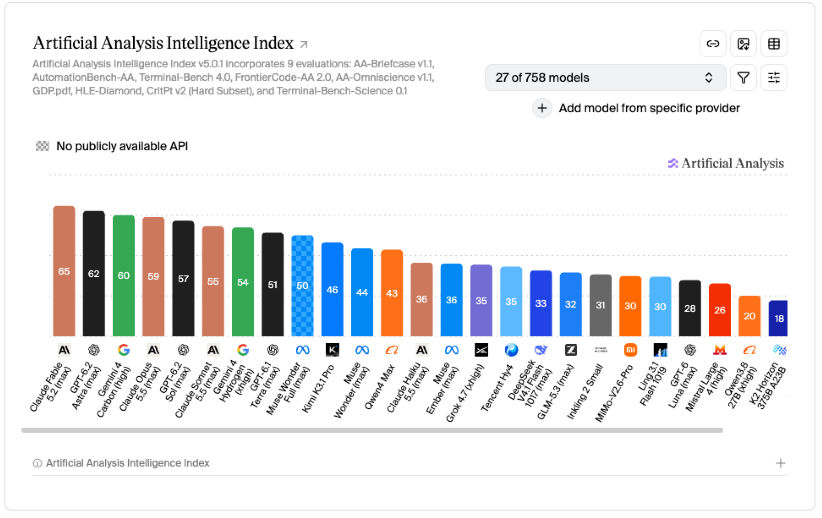
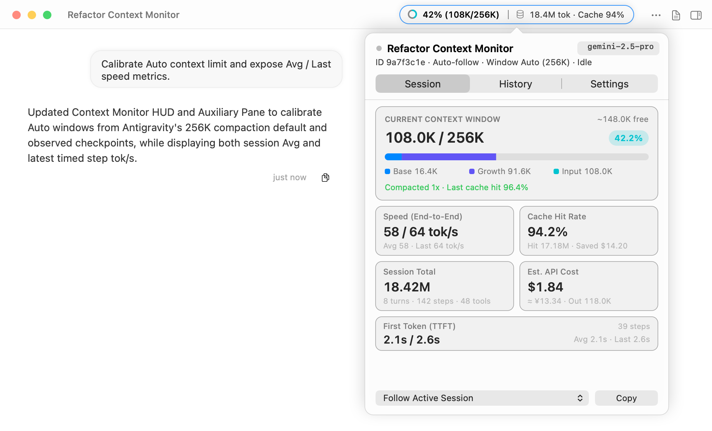
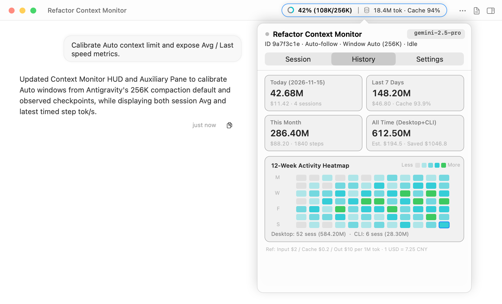
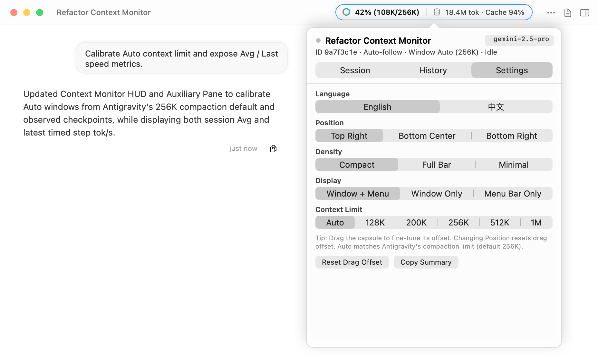
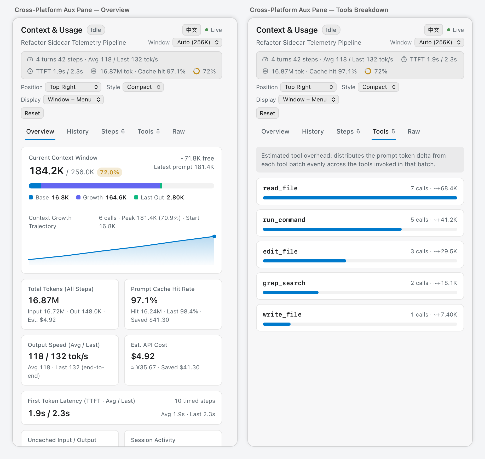

这阵子被 Gemini 4 系列模型吸引了注意力，先是在 [Artificial Analysis](https://artificialanalysis.ai/leaderboards/models) 上看到几个型号排在前面，后来 Google 又把新模型接进了自家的 Google Antigravity，我就装了 Antigravity Desktop 想跑几轮真实的代码和文档任务试试看。

模型能力本身确实能打，但桌面端用上几天之后，我总觉得少点掌控感：当前对话到底占了多少上下文、离自动压缩还有多远、模型停顿几秒是在思考还是首字变慢了，界面上都没有直接反馈。为了心里有数，我基于官方插件与 Sidecar 机制写了 [Antigravity Context Monitor](https://github.com/heywalter/antigravity-context-monitor)，这几天把双语界面、只读隔离和测试整理好后发成了 `v0.2.0`。

如果你不想先装插件，可以先打开 **[交互式演示页](pathname:///demos/context-monitor/index.html)**，在浏览器里拨动对话轮次和窗口标尺，看看界面在不同水位下的变化；代码和发布包可以直接在 GitHub 仓库或 [项目展示页](/showcase) 查看。

<!--truncate-->

## 为什么开始用 Google Antigravity

最开始决定花时间折腾 Antigravity，是因为先在 [Artificial Analysis Intelligence Index v5.0.1](https://artificialanalysis.ai/leaderboards/models) 上注意到了 Google 这代 Gemini 4 的位置。

下面这张是 2026 年 11 月 17 日从 Artificial Analysis 截取的官方排行榜图表：**Gemini 4 Carbon（high）**拿到了 `60` 分，排在整个榜单第三；11 月刚推出的 **Gemini 4 Hydrogen（xhigh）**也有 `54` 分（默认的 `high` 档位是 `51` 分），而且它的单次评测成本只有 `$3.16`（Carbon high 是 `$5.48`），延迟也更轻快。



<p className="article-banner-caption">截图自 Artificial Analysis Intelligence Index v5.0.1（2026-11-17）：Gemini 4 Carbon (high) 为 60 分，Gemini 4 Hydrogen (xhigh) 为 54 分。</p>

Google 在自家的 Antigravity 里直接接入了这批模型，还配了一个 Orchestrator 模式，让偏向规划推理的 Carbon 和偏向快速执行的 Hydrogen 在同一个任务里配合切换。榜单分数只能帮着做初筛，值不值得留在日常工作流里，还是得拉进真实的代码库和文档工程里跑一阵才知道。

## 桌面端用下来缺了点什么

在 Antigravity Desktop 里跑了几天稍长一点的修改任务后，我对模型本身的完成度挺满意，但客户端用起来始终觉得隔着一层黑盒。用习惯了能看清内部状态的开发工具之后，有几件事让我特别想自己盯住：

1. **不知道什么时候会突然压缩**：模型参数上常标着 `1M` 上下文，但长对话跑起来，往往在 `256K` 左右就会触发一次自动压缩（`CHECKPOINT`）。界面上不显示当前占了多少，经常写到一半突然被摘要收口，前面读过的细节就没了。
2. **模型停顿时分不清原因**：扩展思考模型在输出正文前停顿三五秒很常见，但如果不把“首字延迟（TTFT）”和后面的“生成速度（`tok/s`）”分开看，卡住时很难判断到底是模型还在想、还是当前对话上下文太重拖慢了响应。
3. **工具开销和缓存命中看不见**：连续调用几轮 `read_file`、`run_command` 之后，到底是谁把上下文撑起来的，Prompt Cache 有没有持续命中、省了多少输入开销，原本的界面里都没有拆开。
4. **Desktop 和 CLI 的用量各算各的**：有时在桌面端开个头，顺手又在终端用 `agy` 跑几轮脚本，两边的会话用量分开存放，月底回头看的时候很难合在一起统计。

说到底，就是希望能更稳地掌控正在跑的任务：接近阈值前自己先 `/compact` 收尾，发现 Cache 掉下来或者某个工具读入太夸张也能及时调整。既然官方插件文档里提供了 `hooks` 和 `sidecar_sdk`，我干脆自己补了一个监控面板。

## 不改客户端，只读本地文件

做这类客户端观测工具，我给自己定了一个前提：**不改动 Antigravity 应用包里的任何资源，也不要求开远程调试端口（CDP）**。改包在 macOS 上会直接破坏 Apple 代码签名，而且客户端一更新就会被覆盖；挂 `--remote-debugging-port` 平时启动也很别扭。

幸运的是，Antigravity 运行时会在本机留下完整的数据文件，搭配官方的 [`hooks.json`](https://github.com/heywalter/antigravity-context-monitor/blob/main/hooks.json) 和 [`sidecar_sdk`](https://github.com/heywalter/antigravity-context-monitor/blob/main/sidecars/context_monitor/sidecar.json) 就能做纯只读解析：

- `hooks/track_active.sh` 只在 `SessionStart` 和 `PreInvocation` 两个生命周期点记录当前会话 ID 到 `active_hook.json`，不往对话里插任何提示词，不消耗额外 Token；
- Sidecar 只读 Antigravity 自带的三类文件：`transcript.jsonl`（每步的输入、缓存读取、输出 token 与 `CHECKPOINT`）、`annotations/*.pbtxt`（用户重命名后的会话标题）以及 `conversations/*.db`（只读 SQLite 里的步骤时间戳）；
- 整个 Sidecar 没有任何第三方 npm 依赖，只监听本机 `127.0.0.1`，通过 `agy plugin validate` 校验也是 0 error / 0 warning。

## 标题栏悬浮窗与辅助面板

为了平时看一眼不挡视线、需要排查时又能展开细节，我做了两层界面：



<p className="article-banner-caption">macOS 标题栏悬浮胶囊与 Session 面板：显示 Auto (256K) 容量、Base/Growth 占比、Avg/Last 速度、TTFT 与缓存命中率</p>

在 macOS 上，插件会在首次启动时自动通过本地 `swiftc` 编译一个轻量的原生 AppKit 悬浮胶囊（没装 Xcode Command Line Tools 也能正常运行内置网页面板）。平时胶囊就停在窗口标题栏上方，可以直接鼠标拖拽调位置；左键点开是三个标签页：

- **Session**：按 `Auto (256K)` 显示当前窗口剩余余量，把输入拆成相对固定的 **Base** 和随轮次增长的 **Growth**，下面跟着 `Avg / Last tok/s`、`Avg / Last TTFT`、Prompt Cache 命中率、参考 API 成本与活跃会话切换。
- **History**：汇总当天、近 7 天、本月和全部时间的统计，把 Desktop 和 CLI 两边的账并到一块，下面配了一张 12 周（84 天）活跃度热力图。
- **Settings**：随时切换 **English / 中文**、吸附位置、三种胶囊显示密度（Compact / Full Bar / Minimal），或者手动改写 Window Limit。

| 全局历史与 12 周热力图 | 语言、位置与密度设置 |
| :---: | :---: |
|  |  |

<p className="article-banner-caption">History 与 Settings 标签页：Desktop + CLI 用量合并展示，以及随时调整胶囊样式和窗口上限</p>

如果你在 **Linux、Windows** 上用 Antigravity，或者不想在标题栏挂悬浮窗，点击任意对话顶栏的 **`+` → Context & Usage**，就能直接打开全平台通用的 **Auxiliary Pane（辅助面板）**：



<p className="article-banner-caption">全平台 Auxiliary Pane：除了总览指标和上下文增长折线，Tools 标签页还会把每轮工具调用带来的 token 增量分摊回具体工具名</p>

辅助面板的 `Overview` 与 `History` 和悬浮窗保持同步，另外多出了上下文增长曲线、`Steps`（每步耗时与增幅）、`Tools`（按 `read_file`、`run_command`、`edit_file` 等工具估算上下文膨胀贡献）以及方便自己对照排查的 `Raw` 原始 JSON 视图。

## 实现时的几个具体问题

从能跑起来到整理成开源的 `v0.2.0`，下面这三个地方改了不止一版，记下来留个参考。

### Auto 档位为什么默认按 256K 算

最初我图省事，直接拿模型宣传的 `1M` 当分母算百分比。用了一星期就发现这个比例没法看：好几次对话到 `220K~256K` 之间系统就触发 `CHECKPOINT` 压缩了，但 `1M` 分母上的进度条还停在看似安全的 `22%`，起不到提前提醒的作用。

后来我在 `prefs.mjs` 和 `metrics.mjs` 里把 `resolveEffectiveWindowLimit` 改成了四层顺序校验：如果用户在界面手动指定了固定档位（比如 `128K` 或 `1M`），按用户设置算；否则优先去 `transcript.jsonl` 里找历史上已经发生过的 `CHECKPOINT`，取出压前的最大 token 数，通过 `snapObservedCompactionLimit` 贴靠到最近的压缩上限档位（80K、128K、160K、200K、256K、512K、840K、1M）；如果是一轮还没压缩过的新会话，就先按模型公开特征匹配（或默认用 **`256K`**）；万一后续某一步实测用量超出了当前上限，再沿 `WINDOW_LIMIT_TIERS` 自动往上进一档。

### 从只读 SQLite 里读出真 TTFT

只看 `transcript.jsonl` 时，里面记录了每个步骤的 `created_at` 和相邻步骤切换时间，用来算端到端的 `Avg / Last tok/s` 够用了，但缺“模型开始吐出第一段可见内容（含扩展思考）”的时刻，没法直接算 TTFT。

翻了本地数据目录后，发现 Antigravity 在 `conversations/<conv>.db` 的 `steps` 表（`step_type = 15` 即 `PLANNER_RESPONSE`）里写入了 `CortexStepMetadata` 的二进制 Protobuf 数据。于是我在 `ttft.mjs` 里写了不到两百行的纯 JS Protobuf 解码器，并用 Node 自带的 `node:sqlite` 以 `{ readOnly: true }` 只读打开：

- 解析出字段 **`f1` (`created_at`)** 和 **`f6` (`viewable_at`)** 两组时间戳，差值就是和客户端内部耗时一致的真实 `TTFT`；
- 界面同时显示整场会话均值和最近一步（`Avg / Last TTFT`，例如 `2.1s / 2.6s`），方便一眼看出来是前面一直慢，还是最后几轮因为上下文涨起来突然变慢；
- 如果用户的环境跑在还没有内置 `node:sqlite` 的 Node 20 上，`ttft.mjs` 会静默跳过数据库读取，页面把 TTFT 显示为 `—`，其他统计照常工作。

### 还原重命名后的中文标题

在 Antigravity 里重命名一个中文会话标题，最即时的文本通常落在 `annotations/<conv>.pbtxt` 里，而 Go 的 `proto.MarshalTextString` 会把汉字输出成 `\344\270\255` 这种八进制 UTF-8 转义序列。`titles.mjs` 里的 `unescapePbtxtString` 专门按字节把这些序列拼回原始 UTF-8，这样你在客户端里一改名，标题栏胶囊和辅助面板就能跟着切过来。

本地安全方面，我在 [`SECURITY.md`](https://github.com/heywalter/antigravity-context-monitor/blob/main/SECURITY.md) 里做了几点约束：Sidecar 只绑定 `127.0.0.1`、不发任何外部网络请求（界面上的 USD/CNY 参考费用按内置静态费率本地估算）；原生 HUD 进程每次启动时通过随机生成的 `CONTEXT_MONITOR_HUD_TOKEN` 环境变量鉴权调用 `/api/hud`；所有 `conversationId` 都会先过 `ID_RE` 正则校验再去拼接文件路径。

## 跑起来试试

如果想先直观看看界面和各种状态的切换逻辑，可以点下面的在线演示页：

- **[打开交互式演示（支持场景预设、轮次滑块与 12 周热力图）](pathname:///demos/context-monitor/index.html)**
- GitHub 仓库（MIT 开源）：https://github.com/heywalter/antigravity-context-monitor
- v0.2.0 Release（含 macOS Universal 预编译包 `hud_bar-v0.2.0-macos-universal.tar.gz` 与 SHA-256）：https://github.com/heywalter/antigravity-context-monitor/releases/tag/v0.2.0

在终端直接克隆到 Antigravity 插件目录，重启客户端并在 Customizations 里开启 **Context & Usage** 即可使用：

```bash
git clone https://github.com/heywalter/antigravity-context-monitor.git \
  ~/.gemini/config/plugins/context-monitor
```

如果你也在用 Antigravity 跑 Gemini 4 或其他模型，欢迎试一试，有什么好用的指标想法或兼容问题也可以直接来 GitHub 提 Issue 交流。
