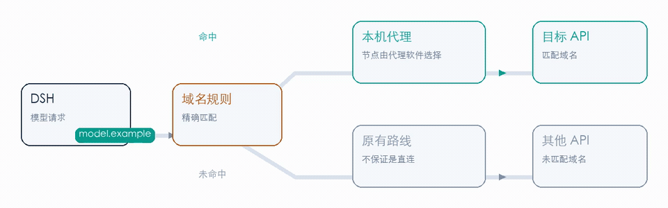
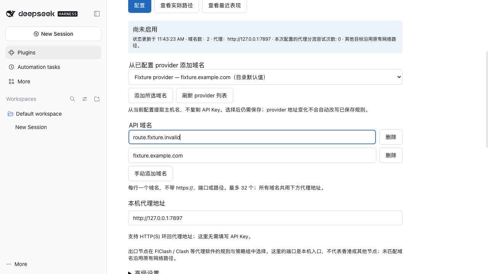
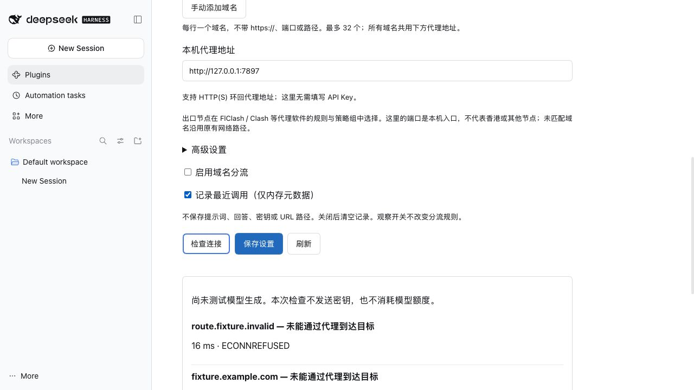
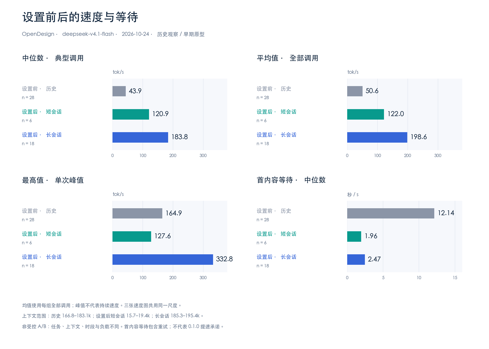
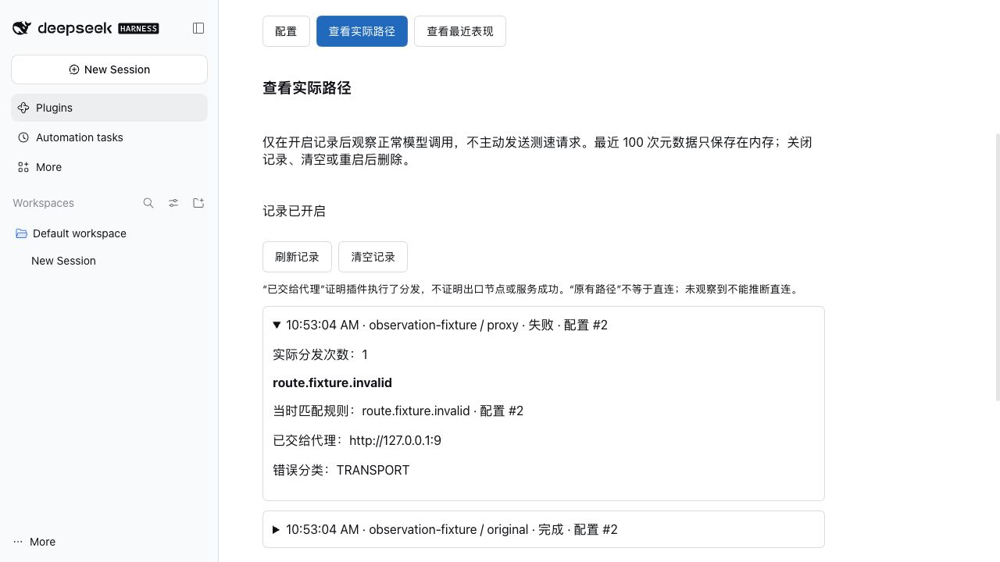
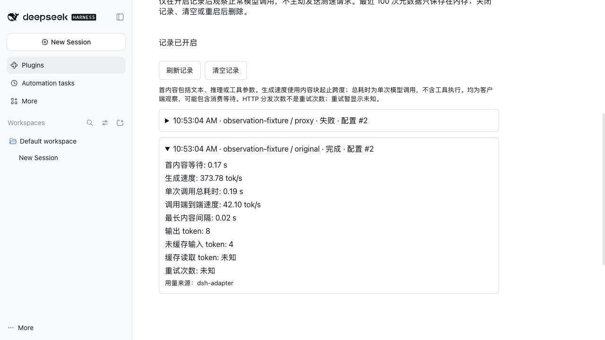
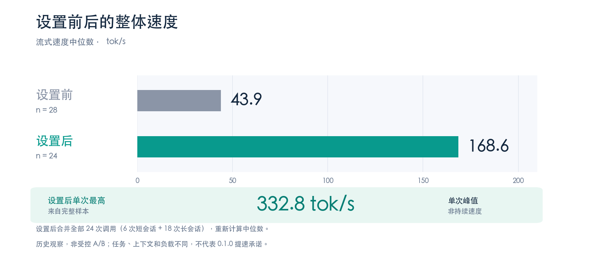
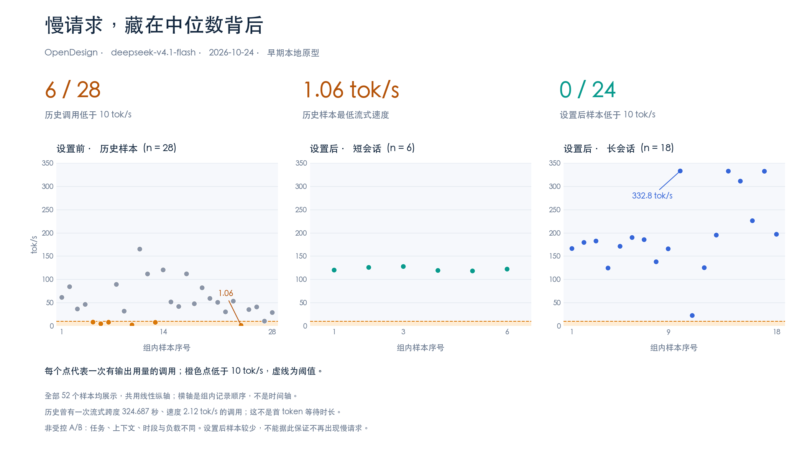

我在日常用 [DeepSeek Harness (DSH)](https://github.com/deepseek-ai/deepseek-harness) 桌面端时，习惯配置几个不同的模型 Provider：部分可以直接直连访问的服务或自建端点，直连速度最快；而部分公共模型 API（比如 Anthropic、OpenAI 或 OpenRouter）则需要通过本地代理软件（如 Clash、FlClash）或者特定网关转发才能稳定连接。

这种混用方式很快带来了一个麻烦：
- 如果开启系统全局代理或 TUN 模式，原生直连端点、内网服务和客户端自身更新不仅被拖慢，有时还会触发服务商的风控或证书异常；
- 如果不开代理，需要特定出口的 API 请求就会直接超时报错；
- 另外，模型打字卡顿或报错时，客户端界面里看不到底层实际走了哪条路线，更不知道到底卡在建连、排队还是生成。

虽然也可以把每个 Provider 的 Base URL 手动改成本地反向代理地址，但每个服务商都要重新折腾一遍 API Key 和证书，切换多端配置很不方便。

为了省去这些折腾，我给 DSH 写了个小插件——**[dsh-domain-proxy](https://github.com/heywalter/dsh-domain-proxy)**。它在 DSH 运行时内部按域名把请求转给本地代理，不用改动任何 Provider 配置；顺便利用 Node.js 的 `AsyncLocalStorage` 记录每次调用的实际路径、首字延迟（TTFT）与吐字速率。自己用了两周感觉挺顺手，顺便整理开源出来。

<!--truncate-->



<p className="article-banner-caption">工作原理：只有加入规则列表的 API 域名会交给本地代理端口转发，其余流量原路直连。</p>

---

## 解决什么问题：按域名分流，不用改 Key

以往让特定模型走代理，通常有两种方式：
1. **改写 Provider Base URL**：把 API 地址改成反代地址。缺点是每个 Provider 都要重新录一遍 Key，如果换机器或更新配置，两边很容易对不上；
2. **全局接管（TUN 模式）**：把系统所有流量全倒进代理客户端。不仅对系统网络侵入大，连 DSH 自己的版本检查或局域网服务都会被影响。

`dsh-domain-proxy` 的思路很简单：**直接在客户端内部按域名分流，不碰已有的 Provider 设置。**

插件启动后会自动读取当前 DSH 已经配置的 Provider 列表并提取主机名。进入设置页，勾选或输入你想加速的域名，再填入本机代理软件的监听端口（例如 `http://127.0.0.1:7890`）即可：



<p className="article-banner-caption">插件配置面板：可直接从 Provider 列表中勾选已有域名，也可以手动输入。</p>

- **命中规则的域名**（例如 `api.anthropic.com`）：由插件交给本地代理转发，实际出口节点由你在代理软件里配置的策略组决定；
- **未命中的其他流量**（如直连模型、自建端点、系统外部链接）：完全走原有网络直连，互不干扰。



<p className="article-banner-caption">控制开关：保存后热生效；自带连通性检查，可以在不发起真实模型请求的情况下测试代理端口是否畅通。</p>

> **配置小提示**：代理地址填的是本地代理软件监听的端口，通常使用 `http://` 即可（即使目标 API 是 `https://`，代理客户端也会自动通过 HTTP CONNECT 隧道处理传输）。

---

## 它是怎么实现的：Undici Dispatcher 拦截

DSH 桌面端基于 Electron / Node.js 构建，底层的 HTTP 调度核心使用的是现代标准的 `undici`。

以前做类似的分流，很多工具会去全局 hook Node 的 `net` 或 `tls` 模块，或者在本地起一个独立的反代服务。但对于桌面客户端插件来说，更轻巧、稳妥的做法是直接介入 Undici 的 Dispatcher：

```text
[DSH 发起 HTTP 请求]
         │
         ▼
[dsh-domain-proxy 路由器]
   ├─ 检查 URL Hostname 是否在规则里？
   │    ├─ 是  ──> 交付给 ProxyAgent (http://127.0.0.1:7890) ──> 本地代理软件 ──> 出口
   │    └─ 否  ──> 交付给原生 inherited Dispatcher ──> 原生网络直连
```

这样做有几个好处：
1. **不污染底层 Socket**：纯粹在 HTTP Client 层分发，不需要改动全局网络核心模块；
2. **连接平滑释放（Graceful Drain）**：当你在设置页修改规则或关闭分流时，正在传输中的流式连接不会被强行掐断，旧连接池排空后平滑注销；
3. **安全边界清晰**：插件的配置和测试接口严格限制在本地回环地址（`127.0.0.1`）；插件只读域名，绝不会读取或存储你的 API Key、Token 或认证请求头。



<p className="article-banner-caption">策略对比：把直连端点与代理分流拆开，避免全量走单一全局通道带来的延迟增加与误拦截。</p>

---

## 顺手看调用数据：首字延迟（TTFT）与真实吐字速率

日常用大模型时，偶尔会觉得“今天怎么这么卡”。但到底是本地网络慢、代理节点拥堵，还是模型服务端本身在排队？客户端原生界面往往没有任何数据支撑。

开启插件的 **记录最近调用** 开关后，在交互界面里就可以看到客观的调用耗时：

### 1. 确认请求有没有按预期走代理

在“实际路径”页，会记录每次调用的目标主机、命中的规则策略以及交付的代理地址：



<p className="article-banner-caption">实际路径记录：清晰展示请求的目标域名以及实际交给了哪套代理分发器。</p>

这样排查就非常明确：一眼就能看出请求到底有没有按规则进入代理通道。

### 2. 几个关键耗时指标

在“最近表现”页，插件统计了流式调用的几项指标：



<p className="article-banner-caption">性能指标面板：记录 TTFT、生成速率以及数据块之间的最大停顿。</p>

- **首内容等待（TTFT，Time to First Token）**：从发起请求到收到第一个有效内容块（包括文字、思考过程或工具调用参数）的时间。它直接体现了网络建连 + 服务端排队响应的速度；
- **流式生成速度（tok/s）**：生成阶段每秒产出的 token 数量，反映模型实际的打字效率；
- **最长内容间隔（Max Chunk Interval）**：流式生成过程中，相邻两次数据推送之间的最大停顿时间。如果这个数值异常高（比如连续停了 3~5 秒），往往代表网络节点丢包或连接抖动。

### 3. 用 AsyncLocalStorage 串起异步流

在 Node.js 里跟踪并发异步流很容易互相串数据。传统做法要么硬改 SDK，要么根据时间戳去猜。

这里借助了 Node.js 原生的 **`AsyncLocalStorage`**：
- 在包装 `llm/stream` 的整个迭代生命周期中绑定调用上下文；
- 无论数据块流转经过多少层 Promise 或异步迭代，调度指标都能准确对齐到当前的调用记录里；
- **纯内存保存与隐私**：记录仅保存在本地内存中（最多存 100 条，重启或手动点击即清除），**绝不抓取** Prompt 提示词、回复正文或 Session ID。

---

## 实测表现参考

自己实际用了几周，最明显的改善是不需要在代理软件里频繁手动切规则了。



<p className="article-banner-caption">实测采样：域名分流让原生直连端点维持最低延迟，同时减少特定 API 的握手重试。</p>

- **原生直连端点无损**：完全绕过代理层，省去了代理软件内部的策略判定和二次转发耗时；
- **代理通道按需生效**：命中域名的请求通过指定的本地策略组出站，连接更稳定；
- **卡顿排查更直观**：结合最长内容停顿时间，能够很快分清是代理节点断流还是模型思考时间长。



<p className="article-banner-caption">调用耗时与频次分布图：多轮采样下直连与分流的耗时分布表现。</p>

---

## 如何在 DSH 中安装与使用

插件已在 macOS Desktop / DSH `0.2.1-rc.3` 环境完成实机验证，采用 MIT 协议开源。

### 安装

1. 打开 [DeepSeek Harness Desktop](https://github.com/deepseek-ai/deepseek-harness)，确保本地代理软件（Clash、FlClash、Surge 等）处于运行状态；
2. 在客户端中打开：**Plugins → Add plugin → Install a third-party plugin**；
3. 输入包名：
   ```text
   dsh-domain-proxy
   ```
   点击 **Install → Enable now**；
4. 安装完成后，完全退出并重启 DSH Desktop 即可。

### 配置

打开 **Plugins → dsh-domain-proxy**（或进入 **Settings** 对应页面）：
1. **添加域名**：从下拉菜单中选取已有 Provider 域名，或手动填入需要代理的主机名；
2. **填入代理端口**：在代理地址中填入实际监听的 HTTP 地址（例如 `http://127.0.0.1:7890`）；
3. **测试并保存**：点击 **检查连接** 确认代理可用后，勾选 **启用域名分流** 并点击保存。

---

## 结语

写这个插件最初只是为了解决自己在多模型混用时一个很具体的麻烦：既不想忍受全局代理的副作用，又想在模型卡顿的时候能看清底层的网络耗时。

如果你平时也在用 DeepSeek Harness，或者在探索类似的 Node.js 流量分流方案，欢迎尝试和交流。

- **GitHub 仓库**：[heywalter/dsh-domain-proxy](https://github.com/heywalter/dsh-domain-proxy)
- **协议**：MIT License
- **详细指南**：可以参考仓库里的 [docs/USAGE.zh-CN.md](https://github.com/heywalter/dsh-domain-proxy/blob/main/docs/USAGE.zh-CN.md) 查看指标口径与更多配置说明。
