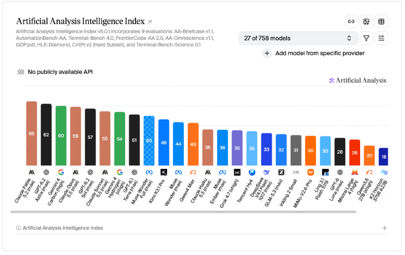
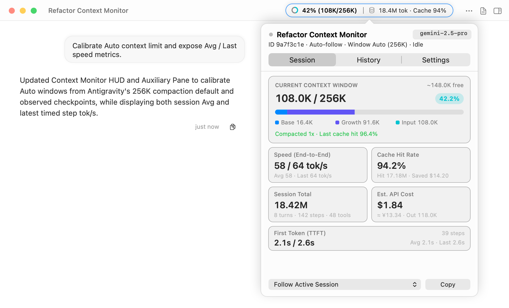
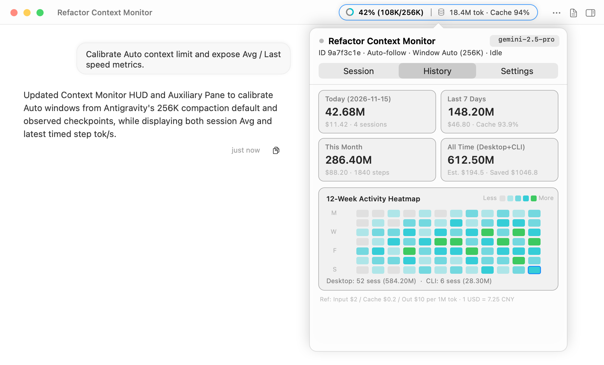
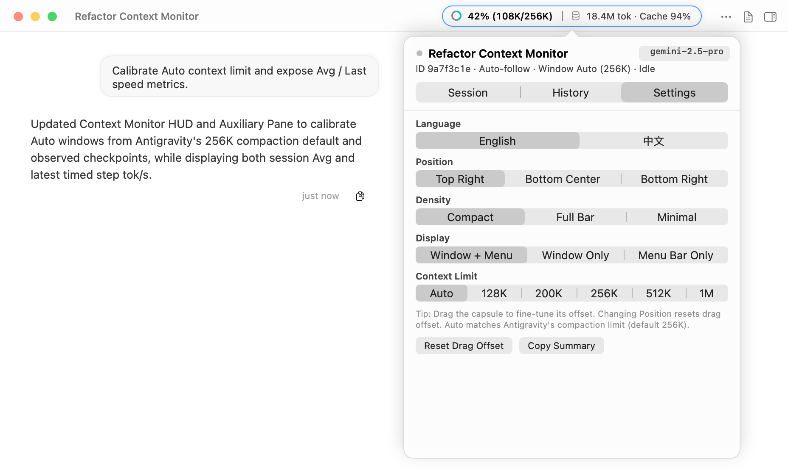
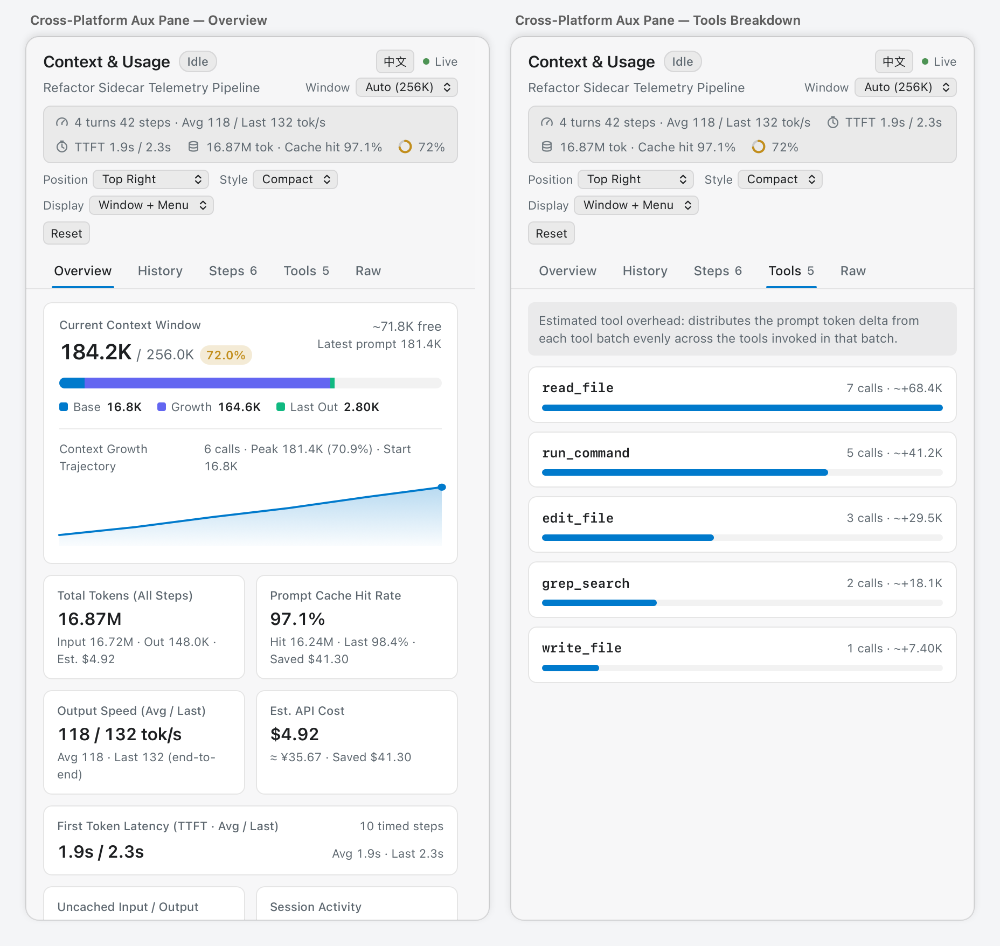

The Gemini 4 lineup caught my eye recently—first after spotting how strong the models looked on [Artificial Analysis](https://artificialanalysis.ai/leaderboards/models), and then seeing them integrated directly into Google Antigravity. I installed Antigravity Desktop to test them on real coding and documentation work.

The models themselves held up well, yet using the desktop client for a few days left me feeling a little blind. I could not tell how full the active context window was, how close a session sat to automatic compaction, or whether a 4-second pause meant deep thinking or rising first-token latency. To keep a tighter handle on my own sessions, I built [Antigravity Context Monitor](https://github.com/heywalter/antigravity-context-monitor) using Antigravity's official plugin and sidecar APIs, and cleaned up the bilingual UI, read-only boundaries, and tests for the `v0.2.0` open-source release.

If you want to preview the layout first, try the **[Interactive Product Demo](pathname:///demos/context-monitor/index-en.html)** directly in your browser, or head to the GitHub repository and [Project Showcase](/en/showcase).

<!--truncate-->

## Why I started using Google Antigravity

I decided to spend real time in Antigravity after checking the [Artificial Analysis Intelligence Index v5.0.1](https://artificialanalysis.ai/leaderboards/models) leaderboard.

Here is the chart captured from Artificial Analysis on November 17, 2026: **Gemini 4 Carbon (high)** sits at **60** near the very top of the leaderboard, while the newer November release **Gemini 4 Hydrogen (xhigh)** reaches **54** (`51` at its default `high` setting) at a much lower benchmark task cost (**$3.16** vs. **$5.48** for Carbon high) with snappier latency.



<p className="article-banner-caption">Captured from Artificial Analysis Intelligence Index v5.0.1 (2026-11-17): Gemini 4 Carbon (high) scores 60 and Gemini 4 Hydrogen (xhigh) scores 54.</p>

Google integrated both tiers into Antigravity along with an Orchestrator mode that hands work back and forth between heavier reasoning (`Carbon`) and faster execution (`Hydrogen`) inside a single thread. Leaderboard scores only tell me which models are worth testing—the real test is still running them inside actual codebases and documentation repos.

## What felt missing in the desktop app

After running multi-step tasks in Antigravity Desktop for a few days, the models delivered good results, but the client UI felt too opaque whenever a conversation stretched out:

1. **Surprise `CHECKPOINT` compactions**: Models often advertise a `1M` context window, yet long sessions tend to trigger automatic `CHECKPOINT` compaction much closer to `256K`. Without seeing live occupancy, a session can suddenly get summarized mid-refactor before you are ready to wrap up.
2. **Hard to tell thinking from stalling**: Extended-thinking models often pause for several seconds before streaming visible tokens. Without separating Time To First Token (`TTFT`) from generation throughput (`tok/s`), a long pause gives no clue whether the model is reasoning cleanly or slowed down by an overloaded prompt.
3. **Hidden tool bloat and cache hits**: After several loops of `read_file` and `run_command`, there was no straightforward way to see which tool batch inflated the prompt, or whether Prompt Cache was still hitting across turns.
4. **Split Desktop and CLI usage**: Sometimes I start a task in the desktop app and run follow-up scripts with `agy` in the terminal. Both write separate local traces, making total usage awkward to track together.

Because I was used to watching these numbers to decide when to `/compact` or split a thread, I wanted better visibility and control in Antigravity too—so I put together this plugin for my own workflow first.

## Keeping it read-only on local files

From day one, I wanted zero fragile hacks: **no patching files inside `Antigravity.app`, and no launching with `--remote-debugging-port` (`CDP`)**. Touching packaged resources breaks Apple code signatures on macOS and gets wiped on the next client update, while relying on CDP flags is clunky for everyday work.

Luckily, Antigravity already writes rich local telemetry on disk. Paired with official [`hooks.json`](https://github.com/heywalter/antigravity-context-monitor/blob/main/hooks.json) and [`sidecar_sdk`](https://github.com/heywalter/antigravity-context-monitor/blob/main/sidecars/context_monitor/sidecar.json), everything stays read-only:

- `hooks/track_active.sh` runs only on `SessionStart` and `PreInvocation` to write the active conversation ID into `active_hook.json`. Nothing is ever injected into prompts, costing `0` extra tokens.
- The Node sidecar reads three existing local artifacts: `transcript.jsonl` (input, cache read, output tokens, and `CHECKPOINT` markers), `annotations/*.pbtxt` (user-renamed titles), and `conversations/*.db` (read-only SQLite step timestamps).
- The sidecar uses zero third-party npm packages, binds strictly to `127.0.0.1`, and passes `agy plugin validate` with `0` errors and `0` warnings.

## Titlebar pill and auxiliary pane

I split the UI into a small glanceable surface for quick checks and a wider pane when I want to dig into individual turns or tools:



<p className="article-banner-caption">macOS Titlebar Capsule &amp; Session Popover — Auto (256K) gauge, Base/Growth split, Avg/Last speed, TTFT, and Prompt Cache hit rate</p>

On macOS, the plugin compiles a small native AppKit floating pill via `swiftc` on first launch (and skips it cleanly if Xcode Command Line Tools are missing). Drag it anywhere along the titlebar, or left-click for a 3-tab popover:

- **Session**: Live `Auto (256K)` headroom, steady **Base** vs. cumulative **Growth** tokens, compaction count, `Avg / Last tok/s`, `Avg / Last TTFT`, Prompt Cache hit rate, reference API cost, and session switching.
- **History**: Today, Last 7 Days, This Month, and All Time totals combining Desktop and CLI sessions above a 12-week (84-day) activity heatmap.
- **Settings**: Quick switching for **English / 中文**, anchor placement, capsule density (`Compact`, `Full Bar`, `Minimal`), and manual Window Limit overrides.

| Global History & 12-Week Heatmap | Language, Placement & Density Controls |
| :---: | :---: |
|  |  |

<p className="article-banner-caption">History and Settings tabs: combined Desktop + CLI usage totals alongside instant layout, language, and window ceiling controls</p>

On **macOS, Linux, and Windows**, clicking **`+` → Context & Usage** in any conversation header opens the built-in **Auxiliary Pane**:



<p className="article-banner-caption">Cross-Platform Auxiliary Pane — Overview trajectory &amp; TTFT cards paired with per-tool context delta attribution</p>

Alongside `Overview` and `History`, the Auxiliary Pane adds a context growth chart, a `Steps` log, a `Tools` breakdown (splitting prompt token growth across tool batches like `read_file`, `run_command`, and `edit_file`), and a `Raw` JSON view for debugging.

## Three details from building it

Turning a personal script into `v0.2.0` meant ironing out three details that initially tripped me up:

### Calibrating Auto to 256K instead of 1M

At first I simply divided current prompt tokens by `1M`. Within a week it was clear why that gave false comfort: Antigravity often compacted threads between `220K` and `256K`, yet a `1M`-scaled gauge sat around `22%`, giving no warning to wrap up early.

In `prefs.mjs` and `metrics.mjs`, `resolveEffectiveWindowLimit` now cascades through four checks: any manual tier picked by the user (`128K`, `1M`, etc.) takes priority; otherwise `snapObservedCompactionLimit` inspects past `CHECKPOINT` peaks in `transcript.jsonl` to match the nearest compaction tier (`80K`, `128K`, `160K`, `200K`, `256K`, `512K`, `840K`, `1M`); for fresh threads with no checkpoints yet, it uses public model hints or defaults to **`256K` (`DEFAULT_AUTO_WINDOW_LIMIT`)**; and if live usage climbs above that tier, it automatically steps up along `WINDOW_LIMIT_TIERS`.

### Reading TTFT from SQLite

Reading `transcript.jsonl` gives `created_at` and transition timestamps for `Avg / Last tok/s`, yet lacks the exact moment the first visible character started streaming.

Digging into the local data folder showed that Antigravity stores `CortexStepMetadata` protobuf blobs in `conversations/<conv>.db` (`steps` table, `step_type = 15`). In `ttft.mjs`, I wrote a compact pure-JS protobuf reader on top of Node's built-in `node:sqlite` (`{ readOnly: true }`):

- Decodes **`f1` (`created_at`)** and **`f6` (`viewable_at`)** timestamps so `TTFT` matches Antigravity's own model first-visible-chunk timing;
- Shows **Session Average / Latest Step (`Avg / Last TTFT`)**, such as `2.1s / 2.6s`, making late-turn latency spikes stand out right away;
- On Node 20 environments without `node:sqlite`, `ttft.mjs` skips database reads silently and falls back to `TTFT —` while every other metric keeps working.

### Decoding renamed session titles

When you rename a conversation inside Antigravity, the latest title lives in `annotations/<conv>.pbtxt`. Go's `proto.MarshalTextString` writes non-ASCII characters as octal UTF-8 escape sequences (such as `\344\270\255`). `unescapePbtxtString` in `titles.mjs` reassembles those bytes cleanly so renamed Chinese or English session titles sync immediately across both UI surfaces.

On the security side (documented in [`SECURITY.md`](https://github.com/heywalter/antigravity-context-monitor/blob/main/SECURITY.md)), the HTTP sidecar listens strictly on `127.0.0.1` with zero outbound network requests (reference USD/CNY estimates use local static rates), protects `/api/hud` with a per-launch random `CONTEXT_MONITOR_HUD_TOKEN`, and validates every `conversationId` against `ID_RE` before reading any log path.

## Demo and installation

To explore the presets, turn scrubber, and heatmap directly in the browser:

- **[Open Interactive Demo (presets, turn slider & 12-week heatmap)](pathname:///demos/context-monitor/index-en.html)**
- GitHub Repository (MIT): https://github.com/heywalter/antigravity-context-monitor
- v0.2.0 Release (includes `hud_bar-v0.2.0-macos-universal.tar.gz` + SHA-256): https://github.com/heywalter/antigravity-context-monitor/releases/tag/v0.2.0

Clone directly into Antigravity's plugins folder, restart the app, and toggle **Context & Usage** under Customizations:

```bash
git clone https://github.com/heywalter/antigravity-context-monitor.git \
  ~/.gemini/config/plugins/context-monitor
```

If you are trying Gemini 4 or running long agent workflows in Antigravity Desktop, feel free to give it a spin and open an issue on GitHub with feedback or compatibility notes.
