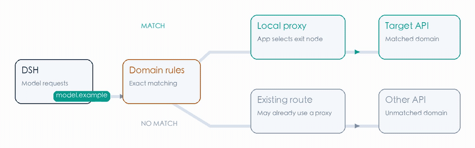
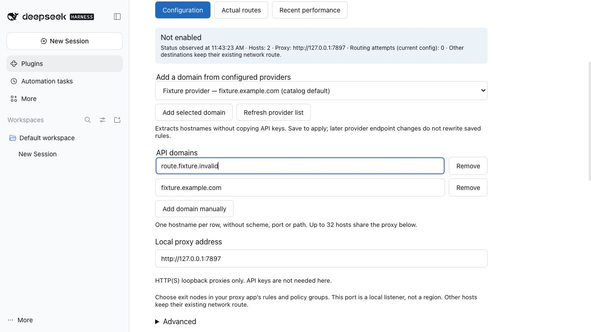
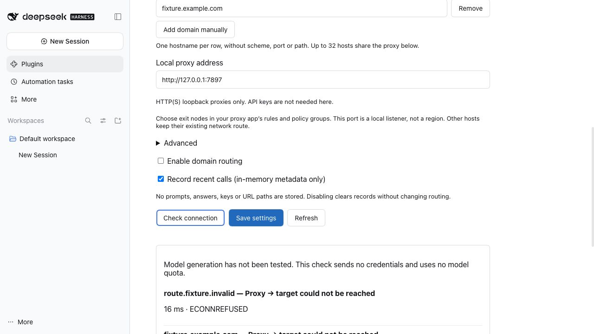
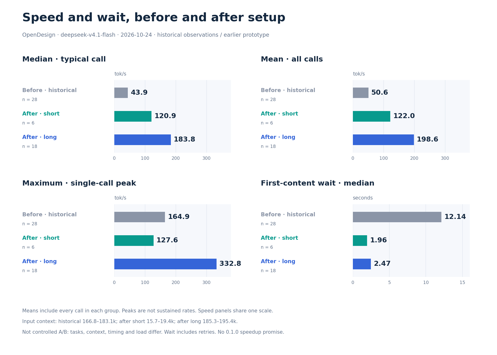
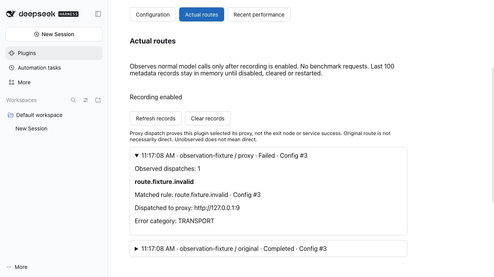
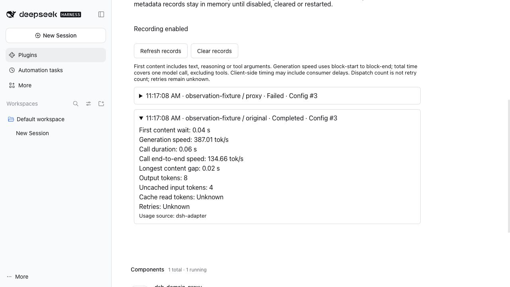
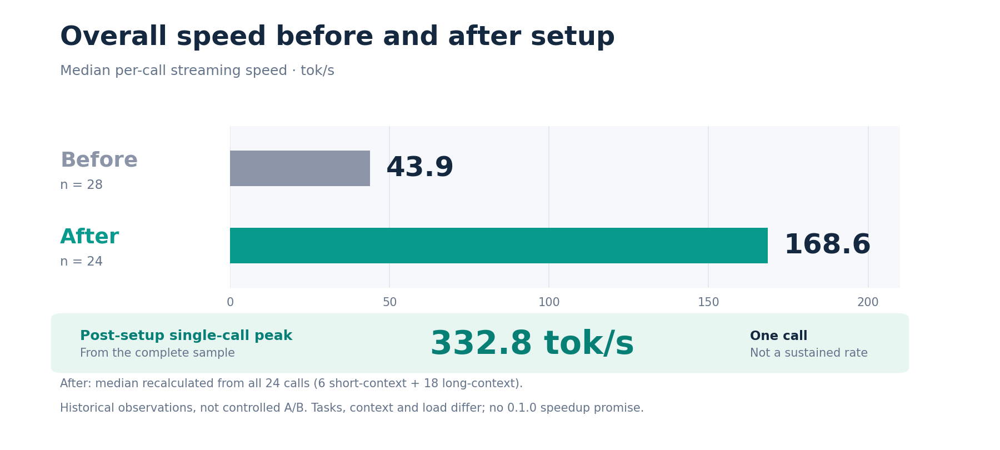
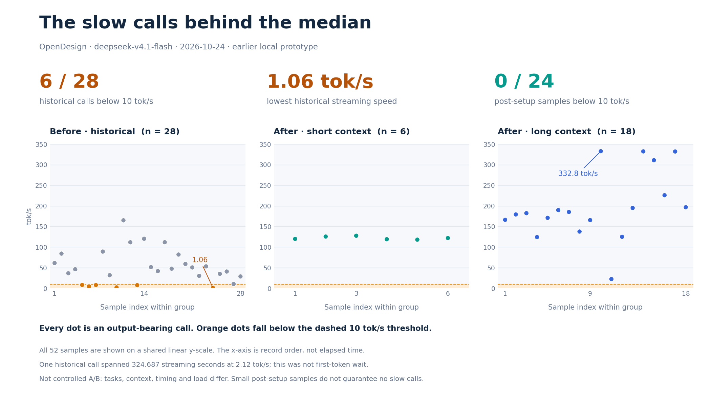

When using the [DeepSeek Harness (DSH)](https://github.com/deepseek-ai/deepseek-harness) desktop client, I usually configure several model providers: some direct or self-hosted endpoints connect fastest over native routes, while certain cloud APIs (such as Anthropic, OpenAI, or OpenRouter) need to route through a local proxy (like Clash or FlClash) or a designated gateway to connect reliably.

Operating mixed providers like this quickly exposed a practical problem:
- Enabling system-wide global proxy or TUN mode adds latency to direct endpoints, local services, and client auto-updates, occasionally triggering provider rate limits or TLS certificate mismatches;
- Leaving proxies disabled causes calls to proxy-dependent APIs to time out immediately;
- When responses stutter or hang, DSH's native interface provides no visibility into what network path was actually taken or whether delays stem from connection handshake, upstream queueing, or generation.

While you can manually rewrite each provider's Base URL to point to a local reverse proxy, having to re-enter API keys across all endpoints and manage duplicate configs becomes cumbersome.

To solve this, I wrote a small DSH plugin: **[dsh-domain-proxy](https://github.com/heywalter/dsh-domain-proxy)**. It splits traffic inside DSH's runtime by target hostname without changing any provider settings. It also uses Node.js `AsyncLocalStorage` to track the actual route, Time-to-First-Token (TTFT), and generation speed for each call. After using it daily for a few weeks, I cleaned it up and open-sourced it.

<!--truncate-->



<p className="article-banner-caption">How it works: Only API hostnames in the rule list route through your local proxy; all other traffic stays on the native direct path.</p>

---

## What It Solves: Domain Routing Without Rewriting Keys

Routing specific models through a proxy usually involves one of two workarounds:
1. **Rewriting Base URLs**: Changing the API host to a local reverse proxy. You have to re-enter API keys for each provider, which easily drifts across multiple devices;
2. **System-wide TUN Mode**: Directing all OS traffic into a proxy client. This is invasive and often interferes with DSH's own update checks or internal network services.

`dsh-domain-proxy` takes a straightforward approach: **split traffic inside the app by hostname, leaving provider configs untouched.**

When enabled, the plugin reads configured providers from DSH and extracts their hostnames. In the settings page, select or type the domains you want to proxy and set your local proxy port (e.g. `http://127.0.0.1:7890`):



<p className="article-banner-caption">Plugin settings: Pick existing provider domains from the dropdown or manually add custom hosts.</p>

- **Matched Domains** (e.g. `api.anthropic.com`): Handed over to your local proxy client; the exit node follows whatever rule group you configured in your proxy app;
- **Unmatched Traffic** (direct models, local endpoints, system links): Stays on DSH's native direct route without interference.



<p className="article-banner-caption">Control toggles: Settings apply immediately on save. Includes a connection checker to verify proxy reachability without spending model tokens.</p>

> **Configuration Note**: The proxy address points to your local proxy software's port and typically uses `http://` (even if the target API is `https://`, your proxy handles the TLS tunnel via HTTP CONNECT).

---

## How It Works Under the Hood: Intercepting Undici Dispatchers

DSH Desktop runs on Electron / Node.js, and modern versions use `undici` for underlying HTTP dispatches.

Instead of monkey-patching Node's global `net` or `tls` modules, or spinning up a separate background proxy server, the cleanest route is intercepting Undici's Dispatcher directly:

```text
[DSH Outgoing HTTP Request]
            │
            ▼
[dsh-domain-proxy Router]
   ├─ Is URL Hostname in the rule list?
   │    ├─ Yes ──> Hand over to ProxyAgent (http://127.0.0.1:7890) ──> Local Proxy ──> Exit Node
   │    └─ No  ──> Pass through to inherited Dispatcher ──> Native Direct Connection
```

This brings three key advantages:
1. **Clean HTTP Dispatch**: Stays cleanly at the HTTP Client layer without touching core runtime socket internals;
2. **Graceful Connection Draining**: When you edit rules or turn off proxying, active streams aren't abruptly killed—old connection pools drain naturally;
3. **Strict Local Boundaries**: API and doctor endpoints only accept local loopback calls (`127.0.0.1`); the plugin only reads domain hostnames and never reads or stores your API keys or request headers.



<p className="article-banner-caption">Routing comparison: Separating direct traffic from proxied routes prevents unnecessary overhead and accidental rate limits.</p>

---

## Tracking Call Metrics: TTFT and Actual Tokens/s

When using models, it's common to wonder why a response feels slow. Is it local network latency, a congested proxy node, or upstream model queueing? DSH doesn't provide these metrics out of the box.

Turning on **Record recent calls** adds practical observability to the UI:

### 1. Verifying That Requests Actually Used the Proxy

Under the "Actual routes" tab, each call shows its target host, matched rule, and dispatched proxy endpoint:



<p className="article-banner-caption">Actual routes view: Shows target hosts and the assigned dispatcher for unambiguous troubleshooting.</p>

This takes the guesswork out: you can immediately see whether a request went through the proxy as intended.

### 2. Key Latency Metrics

Under "Recent performance", the plugin tracks three practical streaming numbers:



<p className="article-banner-caption">Performance view: Records TTFT, streaming generation speed, and the longest pause between chunks.</p>

- **Time-to-First-Token (TTFT)**: Elapsed time from request dispatch until the first non-empty chunk (text, reasoning delta, or tool call arguments) arrives. This reflects connection setup plus upstream queueing latency;
- **Streaming Speed (tok/s)**: Average token generation rate during the active completion phase;
- **Max Content Interval**: The longest pause between two consecutive chunks. If this jumps to several seconds, it usually indicates packet loss or socket jitter along the proxy path.

### 3. Tying Streams Together with AsyncLocalStorage

In Node.js, tracking concurrent streams can easily mix up data across requests. Traditional approaches either require hacking third-party SDKs or guessing correlations by timestamp.

Here, Node.js **`AsyncLocalStorage`** solves the problem cleanly:
- Call context attaches across the full lifecycle of the `llm/stream` iterator;
- No matter how many async promises or `for await` loops a stream passes through, dispatch metrics link directly to the correct call record;
- **Memory-Only & Privacy**: Records stay exclusively in RAM (capped at 100 entries, cleared on restart or manual reset) and **never capture** user prompts, completions, or session IDs.

---

## Real-World Usage Notes

After using this daily for a few weeks, the main convenience is not having to constantly toggle rules or modes in proxy software:



<p className="article-banner-caption">Empirical sampling: Direct routes preserve minimal latency while proxied APIs avoid repeated handshake failures.</p>

- **Direct endpoints stay fast**: Bypassing the proxy layer keeps connection latency minimal without extra hop overhead;
- **Proxied endpoints route cleanly**: Matched domains exit via designated proxy policy groups with fewer handshake drops;
- **Stalls are easy to pinpoint**: Max chunk interval makes it obvious whether a delay was caused by a dropped packet or model compute time.



<p className="article-banner-caption">Call duration and distribution: Comparing response times across direct and proxied runs.</p>

---

## How to Install and Configure in DSH

The plugin has been verified on macOS Desktop with DSH `0.2.1-rc.3` and is licensed under MIT.

### Installation

1. Open [DeepSeek Harness Desktop](https://github.com/deepseek-ai/deepseek-harness) and make sure your proxy software is running;
2. In the app, go to: **Plugins → Add plugin → Install a third-party plugin**;
3. Enter the package name:
   ```text
   dsh-domain-proxy
   ```
   Click **Install → Enable now**;
4. Fully quit and restart DSH Desktop.

### Configuration

Open **Plugins → dsh-domain-proxy** (or navigate to **Settings**):
1. **Add Domains**: Pick existing provider domains from the dropdown, or enter target hostnames manually;
2. **Set Proxy Port**: Enter your local proxy listening address (e.g. `http://127.0.0.1:7890`);
3. **Test and Save**: Click **Check connection** to confirm reachability, check **Enable domain proxy**, and save.

---

## Wrap-up

I built this plugin to solve a specific, recurring pain point in my day-to-day work: avoiding the side effects of global proxies while keeping model latency visible when things feel slow.

If you use DeepSeek Harness or are exploring Node.js traffic dispatching, feel free to try it out or share feedback.

- **GitHub Repository**: [heywalter/dsh-domain-proxy](https://github.com/heywalter/dsh-domain-proxy)
- **License**: MIT License
- **User Guide**: Check [docs/USAGE.en.md](https://github.com/heywalter/dsh-domain-proxy/blob/main/docs/USAGE.en.md) for detailed metric definitions and configuration options.
